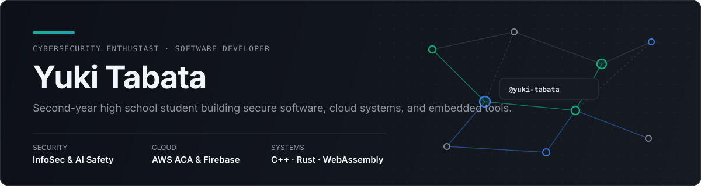
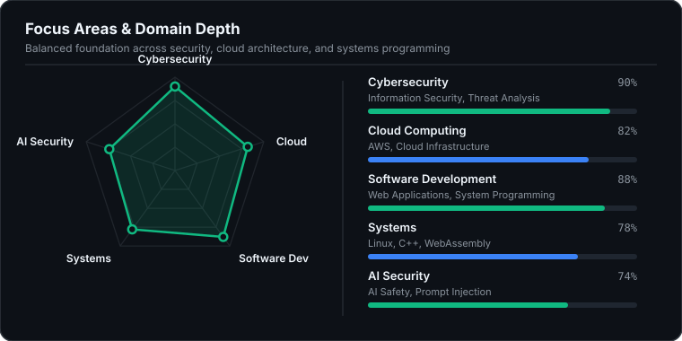
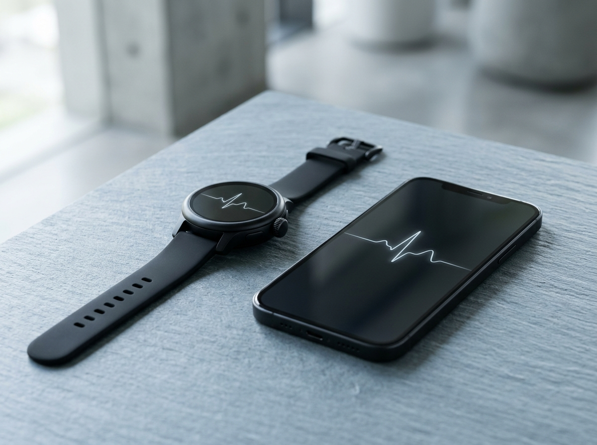
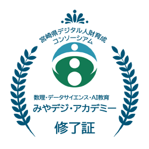
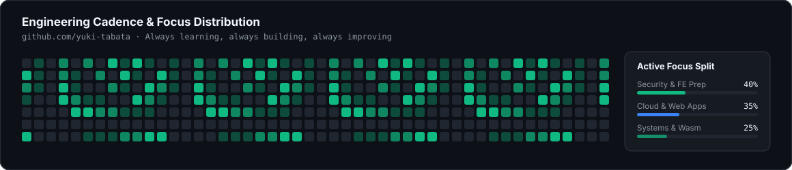

<!-- ================================================= -->
<!--           YUKI TABATA — GITHUB PROFILE            -->
<!-- ================================================= -->

  <picture>
    <source media="(prefers-color-scheme: dark)" srcset="./assets/hero-banner-dark.svg" />
    <source media="(prefers-color-scheme: light)" srcset="./assets/hero-banner-light.svg" />
    
  </picture>

  
  
  
  

---

## whoami

<table>
  <tr>
    <td width="58%" valign="top">
      <h3>About Me</h3>
      

        I'm a <b>second-year high school student</b> passionate about <b>cybersecurity</b> and <b>software development</b>.
      

      

        I enjoy exploring how systems work, understanding security risks, and building practical solutions through programming.
      

      

        I believe technology should be used to protect people and make the digital world safer. My goal is to continuously improve my technical skills and develop technology that makes a positive impact on society.
      

    </td>
    <td width="42%" valign="top">
      <h3>Quick Snapshot</h3>
      <ul>
        <li><b>Role:</b> Cybersecurity Enthusiast &amp; Developer</li>
        <li><b>Certifications:</b> IT Passport · InfoSec Management</li>
        <li><b>Target:</b> Fundamental IT Engineer (FE)</li>
        <li><b>Academy:</b> Miyazaki Univ. Digital Academy (3rd)</li>
        <li><b>Cloud:</b> AWS Academy Cloud Architecting (ACA)</li>
      </ul>
    </td>
  </tr>
</table>

---

## Focus Areas & Competency Graph

  <picture>
    <source media="(prefers-color-scheme: dark)" srcset="./assets/focus-radar-dark.svg" />
    <source media="(prefers-color-scheme: light)" srcset="./assets/focus-radar-light.svg" />
    
  </picture>

| Area | Interests | Key Direction |
|---|---|---|
| 🔐 **Cybersecurity** | Information Security, Threat Analysis | Defense fundamentals, risk modeling, IPA Security |
| ☁️ **Cloud Computing** | AWS, Cloud Infrastructure | AWS Academy ACA, Learner Lab architecture |
| 💻 **Software Development** | Web Applications, System Programming | TypeScript, Vite, Firebase, Swift &amp; SQL |
| 🐧 **Systems** | Linux, C++, WebAssembly | Low-level execution, embedded telemetry, Wasm |
| 🤖 **AI Security** | AI Safety, Prompt Injection | LLM boundary hardening &amp; safe agent workflows |

---

## Tech Stack & Ecosystem

  <picture>
    <source media="(prefers-color-scheme: dark)" srcset="./assets/tech-stack-dark.svg" />
    <source media="(prefers-color-scheme: light)" srcset="./assets/tech-stack-light.svg" />
    
  </picture>

  <b>Programming Languages</b>  
  

  <b>Cloud &amp; Development</b>  
  

---

## Featured Projects & System Architecture

  <picture>
    <source media="(prefers-color-scheme: dark)" srcset="./assets/project-architecture-dark.svg" />
    <source media="(prefers-color-scheme: light)" srcset="./assets/project-architecture-light.svg" />
    
  </picture>

<table>
  <tr>
    <td width="50%" valign="top">
      
      <h4>HealthShare</h4>
      
An information-sharing system connecting <b>Apple Watch</b>, <b>iOS</b>, and <b>SQL</b> for structured health telemetry sync.

      <code>Swift</code> · <code>WatchKit</code> · <code>iOS</code> · <code>SQL</code>
    </td>
    <td width="50%" valign="top">
      
      <h4>motoblog</h4>
      
A web application designed for <b>motorcycle riders</b>, featuring rider profiles, community interactions, and touring functions.

      <code>TypeScript</code> · <code>Web App</code> · <code>Community</code>
    </td>
  </tr>
  <tr>
    <td width="50%" valign="top">
      <h4>School Cafe Ordering System</h4>
      
A real-time web-based ordering system built with <b>Vite</b> and <b>Firebase</b> to manage school event orders cleanly.

      <code>Vite</code> · <code>TypeScript</code> · <code>Firebase</code>
    </td>
    <td width="50%" valign="top">
      
      <h4>Custom Digital Meter</h4>
      
Exploring the design and firmware of a <b>custom digital instrument cluster</b> for motorcycles with crisp gauge telemetry.

      <code>C++</code> · <code>Embedded</code> · <code>Telemetry UI</code>
    </td>
  </tr>
</table>

---

## Certifications & Education Roadmap

  <picture>
    <source media="(prefers-color-scheme: dark)" srcset="./assets/learning-roadmap-dark.svg" />
    <source media="(prefers-color-scheme: light)" srcset="./assets/learning-roadmap-light.svg" />
    
  </picture>

<table>
  <tr>
    <td width="50%" valign="top">
      <h4>Certifications</h4>
      <ul>
        <li><b>IT Passport Examination</b> — Passed</li>
        <li><b>Information Security Management Examination</b> — Passed</li>
        <li><b>Fundamental IT Engineer (FE)</b> — Preparing</li>
      </ul>
    </td>
    <td width="50%" valign="top">
      <h4>Education &amp; Developer Programs</h4>
      <ul>
        <li><b>Miyazaki University Digital Academy</b> — 3rd Cohort Graduate</li>
        <li><b>AWS Academy</b> — Cloud Architecting (ACA)</li>
        <li><b>AWS Academy Learner Lab</b> — Hands-on Cloud Learning</li>
        <li><b>GitHub Education</b> — Member</li>
      </ul>
    </td>
  </tr>
</table>

  
  &nbsp;&nbsp;&nbsp;&nbsp;
  

  <b>AWS Academy</b> &nbsp;|&nbsp; <b>GitHub Education</b> &nbsp;|&nbsp; <b>Miyazaki University Digital Academy</b>

---

## GitHub Analytics & Activity Graph

  <picture>
    <source media="(prefers-color-scheme: dark)" srcset="./assets/engineering-pulse-dark.svg" />
    <source media="(prefers-color-scheme: light)" srcset="./assets/engineering-pulse-light.svg" />
    
  </picture>

  
  &nbsp;
  

  

  

---

## Current Focus & Roadmap

<table>
  <tr>
    <td width="33%" valign="top">
      <h4>🟢 Currently Working On</h4>
      <ul>
        <li>Fundamental IT Engineer (FE) Exam</li>
        <li>AWS Cloud Architecture</li>
        <li>Cybersecurity &amp; AI Security</li>
      </ul>
    </td>
    <td width="33%" valign="top">
      <h4>🔵 Currently Building</h4>
      <ul>
        <li>Personal Development Projects</li>
        <li>Cloud Apps (AWS &amp; Firebase)</li>
      </ul>
    </td>
    <td width="33%" valign="top">
      <h4>🟡 Currently Exploring</h4>
      <ul>
        <li>Linux &amp; System Programming</li>
        <li>WebAssembly</li>
        <li>Information Security</li>
      </ul>
    </td>
  </tr>
</table>

> *Always learning, always building, always improving.*

---

  <i>Learning. Building. Securing.</i>

